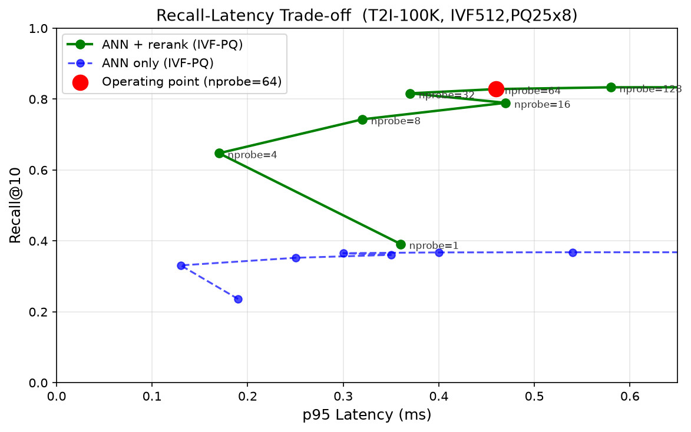

# Fast Retrieval Layer — Design

## The Constraint

100M frames × 512-dim float32 = **205 GB** (200-dim as tested = 80 GB). You cannot scan it. You cannot hold it in RAM cheaply. Every decision below like compression, path selection, filter architecture is a direct response to this.

The design below satisfies 100M+ frames, sub-second latency, and natural language input.


## Full Architecture


# Deep Dive

### Why IVF-PQ

**HNSW** gives better recall but requires full-precision vectors in RAM for distance computation. At 100M frames that is the 205 GB problem again.

*Note: HNSW is used inside the IVF coarse quantizer (`IVF65536_HNSW32`) to quickly find the nearest nprobe cells from 65536 centroids i.e around 52MB graph, not full vectors.*

**IVF** partitions vectors into `nlist` Voronoi cells so a query scans only `nprobe` nearest cells. Codes scanned is close to `N × nprobe / nlist` which is linear in nprobe, and tuneable at query time.

**PQ** compresses each 512-dim vector (2048 bytes) to 64 bytes which leads to one byte per subvector chunk. Scoring a candidate costs 64 table lookups which is fast, no float multiplication. 100M vectors takes about **6.4 GB** in RAM.

*(In our test: 200-dim vectors, PQ25 so 25 bytes/vec which does 25 table lookups so 100M vectors is about 2.5 GB. Same principle, smaller dataset.)*

Trade-off: PQ is lossy so a fine-grained ranking degrades inside compressed codes and thus i have a Rerank to corrects this.

---

### Three Search Paths

Path is chosen on **absolute candidate count**, not fraction (my inital thought was % like 5% but as the scale goes it wont satisfy the SLA so an exact is a better choice):

> 5% of 100K = 5K so cheap brute force. 5% of 100M = 5M therefore 5M × 400 bytes of fp16 reads = seconds and thus violates sub ms SLA.

| Path | When | How |
|------|------|-----|
| A | No filter | Full IVF-PQ scan |
| B | ≤ BF_MAX candidates | Exact brute-force on fp16 subset |
| C | > BF_MAX candidates | IVF-PQ + IDSelectorBitmap |

**BF_MAX is N-dependent.** At 100K, crossover measured at ~5K — Path B is faster below that, Path C above it (B4 benchmark). In code I currently sets BF_MAX = 50K (conservative placeholder, candidates between 5K–50K go to brute-force even though Path C would be faster there). When moving into production, it needs to be recalibrated.

**IDSelectorBitmap:** 1 bit per frame_id. Built with numpy bitwise OR, passed to FAISS as a raw pointer so zero copy. FAISS checks the bit before any distance computation, so filtering happens inside the IVF scan, not after. At 100M frames the bitmap is 12.5 MB per filtered query (100M bits ÷ 8 = 12.5 MB).

---

### Filter Design

**Video/time: VideoTable (in-memory).** Videos have contiguous frame IDs. A timestamp filter is arithmetic:

```
frame_id = video.start_id + floor(timestamp × fps)
```

No DB call. Microseconds.  Reverse lookup (frame_id to video_id) uses bisect on sorted start_ids which results into O(log n) complexity.

**Scene/tag: DuckDB (in-process).** Two tables (`frames`, `frame_tags`), inserted sorted by `(video_id, timestamp)`. Sorted order gives zone maps so a query for one video skips page groups that don't contain it. Tag lookups use a column index. No network hop, a TCP round-trip alone can cost the entire filter budget (and I want to avoid as much as hops to keep it within the required SLA).

Results come back as a numpy array, intersected with the VideoTable range, packed into the IDSelectorBitmap.

---

## Rerank

IVF-PQ returns approximate neighbors. T2I is a cross-modal benchmark (text queries against image vectors) so recall_ann is stable at **~0.37** regardless of nprobe. The gap is inside the PQ compression, not the cell search.

Rerank with exact fp16 vectors recovers recall to **0.83 at 100K, 0.74 at 1M**.

**fp16 on NVMe via mmap.** The rerank store is memory-mapped, not loaded upfront. OS page cache handles warming. Cold queries fault from NVMe, warm repeated queries serve from cache.

fp16 in RAM at 100M = 100 GB per replica (200-dim as tested = 40 GB). The deliberate choice I made is to keep RAM for the compressed index and accept NVMe latency for rerank. SQ8 (~51 GB at 100M for 512-dim, ~20 GB for 200-dim) is the other RAM option that can be considered if disk latency becomes the bottleneck.

---

## Diversification

At 30fps, consecutive frames share near-identical embeddings so without diversification, top-10 results are the same 0.3-second window repeated.

I bucket them as `(video_id, floor(timestamp / 5.0))`. Keep highest-scoring frame per group. Return top-k groups. The 5s window is also tuneable.

On T2I (randomly distributed vectors) this has no visible effect but the mechanism is correct and will show on real video data.

---

## Evidence

**Recall vs latency (nprobe=64):**
- 100K: recall@10 ANN = 0.37, reranked = 0.83, p95 = 0.46ms
- 1M: recall@10 ANN = 0.31, reranked = 0.74, p95 = 0.46ms

The recall gap is inside PQ compression and not cell search which tuning nprobe wont close it but rerank does.



**Cost model — `t_ann = t_overhead + ndis × t_per_code`:**
- 100K: t_per_code = 0.025µs, overhead = 0.017ms, R-sqr = 0.95
- 1M: t_per_code = 0.014µs, overhead = 0.224ms, R-sqr = 0.9935

Linear model holds across a 10× scale jump. R-sqr improves with more data points. The 1M fit is the more reliable input for the 100M projection.

**100M projection (from 1M fit - for production 512-dim/PQ64, our test used 200-dim/PQ25):**
- nprobe=32: 48K codes scanned = 2.0ms
- nprobe=64: 97K codes scanned = 3.8ms
- nprobe=128: 195K codes scanned = 7.4ms
- nprobe=256: 390K codes scanned = 14.5ms

**Budget at 1M (nprobe=64, measured):**
- Text encode (CLIP): not wired — excluded
- Filter resolution: ~2ms — measured
- ANN: 0.41ms p50 / 0.46ms p95 — measured
- Rerank (warm, fits in page cache): ~0.05ms — measured (total p95 0.51ms − ANN p95 0.46ms)
- Diversify: <1ms — measured
- **Total (no CLIP): ~3.5ms p50**

**Budget at 100M (nprobe=64, projected from 1M fit):**
- Text encode (CLIP): ~30ms — assumed, not wired
- Filter resolution: ~2ms — measured (filter is N-independent)
- ANN: ~3.8ms — 1M cost model projection
- Rerank (100 candidates, cold NVMe): ~2ms — assumed (at 1M candidate pages stay warm in OS cache, at 100M candidates are spread across a 100 GB file so cache misses are far more likely)
- Diversify: <1ms — measured
- **Total: ~38ms p50**

10× headroom under 500ms. The rerank jump (0.05ms -> 2ms) is the only assumption not directly grounded so production would use SQ8 in RAM to eliminate NVMe cold reads.

Full benchmark data: `benchmark_results/benchmark_t2i-1m.json`

---

## Known Improvement

- **BF_MAX = 50K is a placeholder** — crossover at 100K is ~5K, needs recalibration at 100M
- **CLIP not wired** — query uses precomputed T2I vectors, encode latency is assumed
- **Rerank cold-cache not measured** — budget uses warm-cache assumption
- **Diversify inactive on T2I** — no real video metadata, mechanism is correct but cant be tested on this dataset
